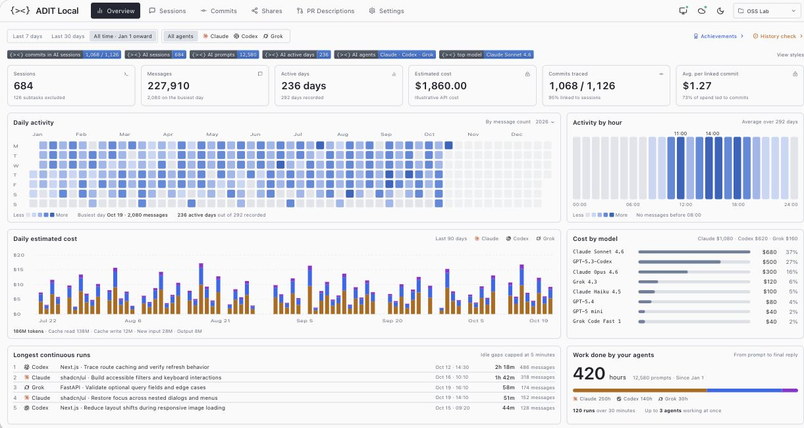

<h1 align="center">{&gt;&lt;} ADIT Core</h1>

<p align="center"><strong>Your AI coding history. All in one place.</strong></p>

<p align="center">Bring conversations together. Trace commits. Recover context.<br>Keep your coding history on your device, ready for you and your Agent.</p>

<p align="center"><a href="https://adit.varve.ai/">Website ↗</a> &nbsp; · &nbsp; <a href="#get-started">Get started</a> &nbsp; · &nbsp; <a href="#reference">Reference</a></p>

<a href="https://adit.varve.ai/"></a>

<p align="center"><sub>ADIT Local overview · Illustrative sample data · <a href="https://adit.varve.ai/">Explore ADIT ↗</a></sub></p>

## Why ADIT?

| What you can do | How ADIT helps |
| --- | --- |
| Find past conversations | Search native coding sessions from different Agents in one place. |
| Understand a code change | Follow commits back to related sessions and recover the context. |
| See your activity | Explore session activity, model usage and estimated costs in the local workbench. |
| Give your Agent context | Use bundled Skills to search history and inspect original turns. |

## Get started

```sh
npm install -g @varveai/adit-cli

cd /path/to/your-project
adit init
adit server
```

Requires Node.js 22 or newer. Installation opens the local workbench. Add a working directory there, or initialize a project from the CLI.

Local history search works without a Cloud account. Cloud storage and automatic synchronization are optional and require explicit setup.

## Reference

<a name="installation"></a>

<details>
<summary><strong>Installation</strong></summary>

Published packages require Node.js 22 or newer. For source development, use
Node.js 22.13 or newer within 22.x, or Node.js 24 or newer, and pnpm 11 or newer.

```sh
npm install -g @varveai/adit-cli
```

Installation updates the bundled Skills, then starts the local background service
or restarts an existing instance and verifies its version, then opens the local
workbench in your browser. Click **Add working directory** to select a project
and start organizing. First service startup enables login startup on supported
systems; an existing disabled preference is preserved. `adit update` performs
the same setup without opening a browser and also retries incomplete setup when
the package is already current. Skill or service
failures are reported as incomplete setup, not a successful upgrade.

Root installations (including `sudo npm install`) report incomplete setup instead
of creating Skills or a service under the wrong account. Install from your regular
account using a writable npm global directory. CI skips user setup; source workspace
dependency installs only update Skills and do not start a background service.
If package lifecycle scripts are disabled, run `adit update` to finish setup.

For a source checkout:

```sh
pnpm install
pnpm build
```

The repository's `install.sh` builds and registers `adit`. Collection hooks and the
old `adit-hook` command are no longer installed.

</details>

<a name="quick-start"></a>

<details>
<summary><strong>Quick start</strong></summary>

```sh
cd /path/to/git-project
adit init
adit server
```

Initialization checks Git first and lets you choose repositories, then discovers
session metadata and lets you choose native session sources. Use the arrow keys
to move, Space to toggle a choice, and Enter to continue. Confirm **Start organizing**
to save the selections and run the same collection process as the Settings page.
Full transcripts are parsed only after this confirmation. For scripts, use
`adit init --yes` to accept the detected selections and start organizing.
Initialization does not change Cloud or automatic synchronization settings.

A project must contain a Git repository, either at its root or in an immediate
child directory. Plain directories cannot be created or organized. A repository
without a configured Git author email can still be registered: session collection
continues, while commit collection shows a configuration hint and is skipped.

Git is checked before session metadata discovery. Full transcript parsing and
commit attribution happen in the shared collection queue. Initial, manual and
automatic collection use the same incremental processing and concurrency control.

</details>

<a name="project-identity-and-storage"></a>

<details>
<summary><strong>Project identity and storage</strong></summary>

`adit init` and the local Settings page call the same registration service. Repeated
initialization preserves the project ID, repository IDs, collected history, Cloud
settings and startup preference. Use `--platform codex` to add a source, or
`--repos .,api,web`, `--single-repo` or `--multi-repo` to explicitly select repositories.
`--force` is a compatibility flag; it does not reset identity or data.
`--absorb` and `--detach` are retired.

An old project's identity and exclusion/deletion policies are adopted once from its
existing manifest, or read-only identity fields in its old database. Old events,
diffs and snapshots are not imported. Initialization does not write, migrate or
delete project `.adit` files, modify `.gitignore`, or install collection hooks.
After adoption, normal commands rely on the shared registry. Reading history never
silently registers a project. Conflicting identities require correction in Settings.

After renaming or moving a project, update its working directory in Settings.
Identity and history stay attached to the same project. If Git disappears, existing
history remains readable while new organization is blocked.

| Data | Location |
| --- | --- |
| Projects, sources, history, Git, attribution and preferences | `<data-root>/local.sqlite` |
| Cloud account, encrypted credentials, links and upload receipts | The same `local.sqlite` |
| Agent relay/runtime state and session context | `<data-root>/runtime/<project-id>/` |
| Background service state | `<data-root>` |

The data root defaults to `~/.adit`. Set `ADIT_LOCAL_DATA_DIR` consistently for the
CLI and service to use an isolated development or test database. This user-level
folder remains supported. Project-local `.adit` is no longer a runtime requirement.

Legacy `ADIT_DATA_DIR`, `ADIT_DB_PATH`, `ADIT_PROJECT_ROOT`, `ADIT_CLIENT_ID`,
`ADIT_REMOTE_URL`, `ADIT_CAPTURE_ENV` and project `settings.json` no longer determine
project storage or identity. `adit config` explains the current storage paths.
The machine ID is stored globally; an existing global `client-id` is adopted once.

</details>

<a name="local-commands"></a>

<details>
<summary><strong>Local commands</strong></summary>

| Command | Behavior |
| --- | --- |
| `adit init` | Choose Git repositories and session sources, then start organizing |
| `adit server` | Start the background service if needed and open the local workbench |
| `adit tui` | Open the same local workbench |
| `adit status`, `adit config` | Read shared project state and paths |
| `adit doctor --fix` | Check shared storage and remove obsolete collection hooks |
| `adit list`, `adit timeline` | List collected native sessions |
| `adit search <text>` | Search collected sessions |
| `adit show <id>` | Read a native session or turn |
| `adit prompt <turn-id>` | Read a collected prompt, with pagination |
| `adit history --help` | Search across Agents and inspect original turns and commit evidence |
| `adit export session <session-id> --output history.json` | Export native turns, including full paginated content |
| `adit export event <turn-id> --output turn.json` | Compatibility command using an exact native turn ID |
| `adit uninstall --yes` | Delete only this project's local ADIT data through the shared deletion service |

Legacy event IDs are not guessed or converted to native IDs. Old actor/event
filters, per-turn snapshots, environment snapshots and `debug db clear-events`
are retired with explicit guidance. Git commit diffs remain available in the local
workbench. Project deletion preserves other projects, shared credentials and Cloud
data; the CLI shows a preview without `--yes`.

</details>

<a name="collection-hooks-and-cloud-relay-hooks"></a>

<details>
<summary><strong>Collection hooks and Cloud relay hooks</strong></summary>

Native history collection does not require Hooks. `init`, `doctor --fix` and Cloud
Agent launch clean only recognized old ADIT collection entries in project Agent
configuration. Mixed user hooks and Cloud relay command strings are retained.
Invalid configuration is reported with its filename instead of being overwritten.

`adit hook list` / `validate` inspect obsolete entries; `adit hook uninstall` removes
them. `hook install` and its old `--clean` behavior are retired. User `.codex`,
`.claude` and trust settings are never removed as a group.

`adit cloud codex` and `adit cloud claude` retain their separate realtime relay
Hooks for Cloud panel operations, interruption and status updates. They store
runtime data under the global project runtime directory. Ordinary Agent use
without the injected relay endpoint does not send relay events.

</details>

<a name="cloud-login-and-synchronization"></a>

<details>
<summary><strong>Cloud login and synchronization</strong></summary>

```sh
adit cloud login
adit cloud login --token adit_DEVICE_TOKEN
adit cloud sync
adit cloud status
adit cloud logout
```

Login/logout work from any directory. Device authorization and device-token login
use the same account service as the local page, storing the returned account name
and encrypted credentials in the selected database. Invalid tokens do not overwrite
a valid login. Cancelled or replaced requests cannot restore a logged-out account.
Legacy `~/.adit/cloud-credentials.json` is not read or imported.

Enable Cloud storage in the project's Settings before syncing. `cloud sync` starts
the local service if needed, runs the shared incremental collection and upload
pipeline, and waits for its result. Automatic sync additionally requires explicit
**Start automatically when you sign in** consent. Initialization never enables it.

Sync sends prompts (including image-only and unanswered prompts), completed replies,
model/token usage, project/repository metadata, commits and local attribution.
Tool calls and per-turn full diffs are not uploaded. Existing server history and
confirmed local receipts establish the upload boundary; logout/reset do not clear
that boundary. Local edits/deletions after upload do not delete Cloud history.

`adit cloud auth reset --yes` clears the current shared login without requiring a
project database. `ADIT_CLOUD_URL` selects the server before login; disconnect before
changing servers. Browser and CLI must use the same data root and Cloud address.

`adit cloud link` retains Git branch/commit and document association, including
`--force`, `--skip-docs`, `--skip-commits`, `--dry-run` and `--json`. It reads registered
repository identity, validates paths/remotes, and caches confirmed link state in the
shared database. It never creates project-local storage. Cloud-deleted/excluded
repositories are omitted from uploads while local history remains readable.

</details>

<a name="cloud-queries-and-coding"></a>

<details>
<summary><strong>Cloud queries and coding</strong></summary>

`adit cloud codex [cliArgs...]` and `adit cloud claude [cliArgs...]` connect the local
Agent to Cloud Coding using the shared account and project identity.

| Command | Description |
| --- | --- |
| `adit cloud tasks list --json` | Query your unfinished tasks using the current project's linked team, or its personal scope if no team is linked |
| `adit cloud tasks scopes --json` | List only the current project's accessible linked teams; use `tasks list --team <id>` if more than one is linked |
| `adit cloud tasks show <taskId> --json` | Read an assigned task, permissions and current update timestamp |
| `adit cloud tasks context <taskId> --json` | Read the task, current PRD and attachment/sketch URLs without downloading files |
| `adit cloud tasks update <taskId> --state done --json` | Update Cloud immediately and record task history |
| `adit cloud projects list --json` | Your own projects; add `--scope visible` to include team projects your role allows |
| `adit cloud teams list --json` | Your teams with your role (owner, lead or member) in each |
| `adit cloud sessions current --json` | The collected native session in this directory and its confirmed Cloud mapping |
| `adit cloud sessions search <query> --from <date> --to <date> --json` | Find your sessions by words in their outline titles, keywords or descriptions |
| `adit cloud sessions list --from <date> --to <date> --json` | Your sessions in a period, newest first |
| `adit cloud sessions show <sessionId> --json` | A session's summary and outline (`current` stands for this session) |
| `adit cloud sessions events <sessionId> --section <n> --json` | A session's events by outline section or page, truncated per field |
| `adit cloud sessions link create <sessionId> --json` | One-hour read link for another assistant; also `status`, `renew`, `revoke` |
| `adit cloud commits explain <sha> --json` | Your session prompts and responses recorded around a commit |
| `adit cloud usage --by model --json` | Token usage and estimated cost, by model, day, session or team member |
| `adit cloud reports daily --json` | Daily work reports as work cards with evidence |
| `adit cloud team members --team <id> --json` | A team's members and roles |
| `adit cloud team progress --team <id> --member <id> --query <text> --json` | A member's tasks, sessions, evidence and commits for a feature |

`projects list`, `sessions list`, `sessions search` and `commits explain` accept
`--scope me|visible` and default to `me`. `visible` includes only data your
existing permissions allow; an empty result never expands the scope. Session
ownership, not the Git author name, determines whose commit explanations are
included. Team, project and member filters narrow the selected scope;
`--scope me --member <someone-else>` is an error. Project `--kind personal|team`
remains supported: `--kind team` without `--scope` keeps its old meaning, while
explicit `--scope me --kind team` is an error. JSON responses echo `scope.kind`;
update the Cloud server before the CLI, since an older server cannot confirm
these scope guarantees and its query results are rejected by the new CLI.

</details>

<a name="skills"></a>

<details>
<summary><strong>Skills</strong></summary>

Five skills are installed automatically by `adit init`, `adit update`, and
published npm installs with lifecycle scripts enabled: `adit-tasks` (the user's
own tasks), `adit-history` (sessions, commits and read links),
`adit-reports` (daily and weekly reports, token usage, team progress),
`adit-memory` (personal and project memory), and `adit-pr` (PR AI usage disclosures). Each is
placed in `~/.agents/skills/<name>/SKILL.md` and `~/.claude/skills/<name>/SKILL.md`.
Already-running AI sessions may need restarting to discover them. Upgrades refresh
unmodified ADIT-owned copies; custom or unrelated existing skills are not overwritten.
If lifecycle scripts were disabled, run `adit update` to install the skills and start the service.

The history and report commands work from any directory; only
`adit cloud sessions current` reads the local project database, because the
session recorded here and its unsynced events are only known locally. Dates are
calendar days sent with this machine's time zone. Team queries about other
members are allowed for owners and leads; members can only query themselves.

Ask your AI assistant "What tasks do I still need to finish?" and then select a
task to implement. The skill queries live data and keeps the real task ID,
reads the related PRD and directs the AI to read relevant resource URLs itself.
Independent tasks have no PRD and use their own requirements and attachments.
Both task listing and scope discovery send the current local project ID. Team
resolution reuses repository mounts, not all account memberships. One linked
team is selected automatically; several require choosing one of that project's
teams. Without a linked team, listing uses personal project tasks. Use
`--personal` to explicitly select personal tasks, or `--team <id>` to select a
linked team. Unrelated teams are rejected even if you belong to them. Responses
identify the source project and effective scope. Lists are paginated and return
`nextOffset`; changing pages must preserve the same project and scope.

"Work on this task" does not mark it completed. An explicit request to mark it
done runs an update, without requiring `adit cloud sync`. To postpone a task:

```bash
adit cloud tasks show <taskId> --json
adit cloud tasks update <taskId> --due 2026-09-30 --expected-updated-at <updatedAt> --json
```

Assignees may update their own state and due date; other edits retain existing
management permissions. A supplied stale `updatedAt` is rejected with HTTP 409;
without one, the CLI reads the current version before attempting the update.
Private resource URLs expire after 15 minutes and must not be published or
committed. Re-query context to refresh them. No task snapshots or attachment
files are cached by these commands. These commands require Cloud task API support.

</details>

<a name="development"></a>

<details>
<summary><strong>Development</strong></summary>

```sh
pnpm build
pnpm typecheck
pnpm test
pnpm lint
pnpm format:check
pnpm test:quality
```

Lint checks all TypeScript and TSX source and test files, excluding generated
files. Potential correctness problems remain errors. Explicit `any` in production
code, unused bindings and readability improvements are warnings; these do not
relax the existing TypeScript compiler checks. Only test files allow explicit
`any` and generators without `yield` for fixtures and mocked streams. Parameters
and caught errors named with a leading `_` may intentionally be unused. Empty
catch blocks must explain why ignoring the error is safe; blanket suppression is
not the cleanup strategy. Other exceptions need a local rationale and review.

`pnpm format:check` checks working-tree contents of staged, unstaged and untracked
source files changed from `HEAD`. Use `pnpm format:check --base <branch-or-commit>`
to also include committed branch changes since the common ancestor. Missing refs
fail the check. `pnpm format` formats only that same changed-file scope and does
not stage files. Generated files are excluded; a no-files result is not a full
formatting pass. `pnpm format:check:all` retains the complete historical report.
Formatting follows the existing two-space, double-quote, semicolon, trailing-comma
style with a 100-column target. Historical reformatting and behavior fixes are
reviewed separately after rule triage, rather than aiming to clear a raw count.

Packages: `core` owns shared storage, native collection and project identity;
`engine` supplies Git operations; `cloud` supplies the Cloud SDK; `cli` provides
commands and the local service; `local-web` provides the workbench.

Useful environment settings include `ADIT_LOCAL_DATA_DIR`, `ADIT_CLOUD_URL`,
`ADIT_CODEX_BIN`, `ADIT_INSTALL_DIR`, `ADIT_PLAIN` and `NO_COLOR`. Configure collection
and synchronization in shared Settings rather than legacy hook threshold variables.
Native source overrides such as `CODEX_HOME` and `CLAUDE_CONFIG_DIR` remain supported.

Release maintainers: see the [release procedure](docs/releasing.md) for branch
checks, rehearsals, package validation, publishing, and recovery after failures.

</details>

## Security

Report suspected vulnerabilities privately using the [security policy](https://github.com/VARVE-ai/adit-core/blob/main/SECURITY.md).
Do not post credentials or private conversation data in public issues.

## License

ADIT's original code is [MIT-licensed](https://github.com/VARVE-ai/adit-core/blob/main/LICENSE).
Third-party components retain their own licenses and terms; in particular, the
Claude Agent SDK is governed by Anthropic's terms, not ADIT's MIT license.
See the [third-party notices](https://github.com/VARVE-ai/adit-core/blob/main/THIRD_PARTY_NOTICES.md)
and the bundled license texts included with the CLI package.
